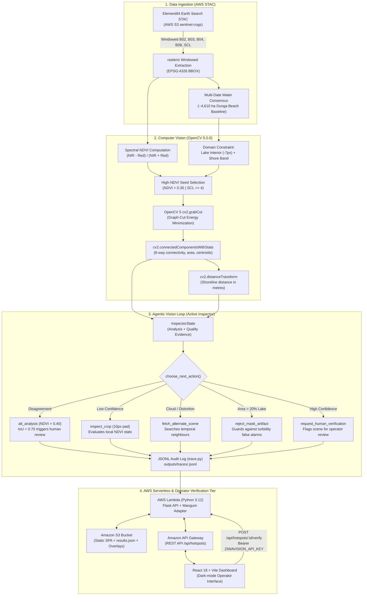
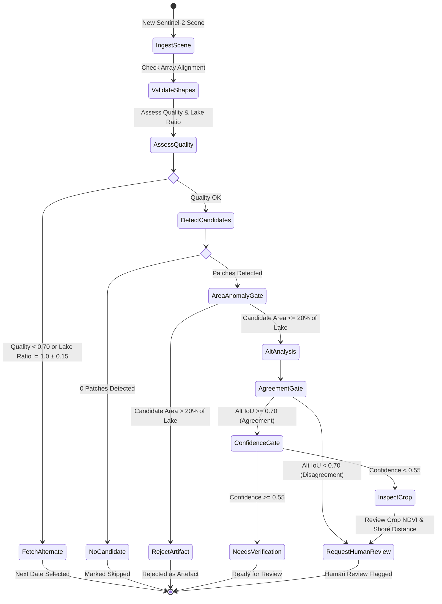

# ZiwaVision — Autonomous Visual Hotspot Verification

**Satellite-Derived Environmental Inspection Prototype for Lake Victoria**  
**Submission for the OpenCV AI Competition 2026, powered by AWS**  
- **Primary Focus Track:** Agentic Vision with OpenCV 5  
- **Secondary Track:** Best Use of COOL (AWS Graviton)  
- **Parent Initiative:** [ZiwaClear](https://ziwa-clear.vercel.app/) — A climate-smart biomass marketplace transforming invasive water hyacinth into clean bio-products.  

---

## 🏆 Competition Judge's Navigation Suite

For technical judges evaluating ZiwaVision, comprehensive technical dossiers are available directly within the repository:

| Document | Focus Area | Description |
|---|---|---|
| 📑 **[`docs/External/competitionDOssier.md`](file:///home/grace/Projects/CODEINE/hackathonTingz/ZiwaVision/docs/External/competitionDOssier.md)** | **Master Judge Dossier** | Complete competition submission overview, end-to-end architecture, and evaluation summary. |
| 🤖 **[`docs/External/agenticEvidence.md`](file:///home/grace/Projects/CODEINE/hackathonTingz/ZiwaVision/docs/External/agenticEvidence.md)** | **Agentic Vision Special Prize** | Empirical evidence, state machine diagrams, and traces where visual results change subsequent decisions. |
| 🔬 **[`docs/External/openCVImplementation.md`](file:///home/grace/Projects/CODEINE/hackathonTingz/ZiwaVision/docs/External/openCVImplementation.md)** | **OpenCV 5 Deep-Dive** | Detailed implementation of `cv2.grabCut`, morphological ring buffers, connected components, and distance transforms. |
| ☁️ **[`docs/External/awsDeployment.md`](file:///home/grace/Projects/CODEINE/hackathonTingz/ZiwaVision/docs/External/awsDeployment.md)** | **AWS Architecture & COOL Track** | Serverless Lambda + API Gateway + S3 architecture, SAM template, and Graviton (`arm64`) optimizations. |
| 📊 **[`docs/External/evaluationAndFailureCases.md`](file:///home/grace/Projects/CODEINE/hackathonTingz/ZiwaVision/docs/External/evaluationAndFailureCases.md)** | **Evaluation & Failures** | Multi-temporal results over 12 real acquisitions and the 6-scenario controlled fault injection test suite. |
| 🚀 **[`docs/External/reproducibilityRunbook.md`](file:///home/grace/Projects/CODEINE/hackathonTingz/ZiwaVision/docs/External/reproducibilityRunbook.md)** | **Reproducibility Runbook** | 5-minute terminal guide to run the 74 automated tests, execute live satellite demos, and launch the app. |
| ⚖️ **[`docs/External/limitationsAndEthics.md`](file:///home/grace/Projects/CODEINE/hackathonTingz/ZiwaVision/docs/External/limitationsAndEthics.md)** | **Ethics & Responsible AI** | Prototype scope, physical sensor boundaries (10 m), community impact, and human-in-the-loop safety. |

---

## The Ecological & Operational Challenge

Water hyacinth (*Pontederia crassipes*) is an aggressive invasive macrophyte on Lake Victoria. It doubles in biomass every 5–15 days under favorable tropical conditions, creating dense floating mats that trap artisanal fishing boats in bays, deplete dissolved oxygen, obstruct freshwater intakes, and disrupt transport ferries.

Through **ZiwaClear**, local harvesters collect floating hyacinth and sell it to processing hubs for conversion into bio-fertilizer, biofuel briquettes, and artisan handicrafts. ZiwaClear manages worker payouts and logistics via SMS/USSD and mobile money (M-Pesa).

### The Operational Bottleneck: Blind Dispatch
Harvesters face a critical limitation: **nobody knows where the weed mats will be tomorrow, or even today**. Wind and lake currents drift massive mats across the open gulf overnight. Harvesters waste valuable fuel, physical labor, and daylight scouting blind across open water.

Direct satellite monitoring is also challenging:
- **Cloud cover & haze:** Equatorial lakes experience frequent cloud cover and localized atmospheric interference.
- **Complex coastlines:** Shoreline vegetation, papyrus swamps, and algae blooms often trigger false alarms on simple vegetation index maps.
- **Verification gap:** Sending a commercial harvesting boat based on an unverified satellite pixel blip is costly and potentially hazardous.

### The ZiwaVision Prototype
ZiwaVision is an autonomous visual inspection prototype designed to verify whether satellite-derived observations can reliably guide environmental follow-up. It is explicitly positioned as an **investigative prototype**, not a validated lake-wide operational monitoring system. It does not replace existing institutional research (such as KMFRI or LVBC), but investigates how agentic computer vision can bridge the gap between raw Earth observation pixels and responsible field dispatch.

> **Strict Language Invariant:** In compliance with scientific rigor, all automated detections are formally designated as **candidate floating vegetation** (never "hyacinth") until a qualified human operator verifies the observation.

---

## End-to-End System Architecture



---

## Agentic Vision: The Active Inspector

Rather than treating a single computer vision pass as ground truth, the **ZiwaVision Active Inspector** investigates suspected hotspots using a fixed, deterministic tool menu:



### Visual Findings Changing Subsequent Decisions:
- **Case 1 (2026-08-23):** Primary detection found 1 patch ($110.86\text{ ha}$). Running `alt_analysis` at higher threshold ($0.40$) yielded $\mathrm{IoU} = 0.141 < 0.70$. Because the visual analyses disagreed, the agent branched from autonomous acceptance to `request_human_verification`.
- **Case 2 (2026-08-28):** Clear-lake baseline produced an apparent $2,080.79\text{ ha}$ detection ($45.1\%$ of lake). The agent recognized an implausible area fraction ($> 20\%$) and routed to `reject_mask_artifact`, preventing a massive false alarm.
- **Case 3 (Cloudy Scenes):** Quality gate $Q < 0.70$ or lake area ratio outside $[0.85, 1.15]$ dynamically branches to `fetch_alternate_scene`, selecting the next-best temporal neighbor from STAC.

---

## Test Site & Key Metrics

| Metric | Value |
|---|---|
| **Primary Test Sector** | Dunga Beach, Winam Gulf, Lake Victoria, Kenya |
| **Bounding Box** | `[34.73, -0.22, 34.83, -0.12]` (W, S, E, N, EPSG:4326) |
| **Pixel Resolution** | 10 m ($1 \text{ pixel} = 0.01 \text{ ha}$) |
| **Reference Lake Area** | ~4,610 ha (multi-date consensus across clear scenes) |
| **Reference Scene Date** | 2026-08-28 (0.0% cloud cover, 100% lake coverage) |
| **Shore Buffer Zone** | ~4,536 ha (3 px inside / 5 px outside lake edge) |
| **Test Coverage** | 74 automated unit & integration tests passing |

---

## Quick-Start & Verification (5 Minutes)

### 1. Environment Verification
```bash
source venv/bin/activate
python --version   # Must be Python 3.12+
python -c "import cv2; print('OpenCV Version:', cv2.__version__)" # Expected: 5.0.0
```

### 2. Run Automated Test Suite (74 Tests)
```bash
ZIWAVISION_API_KEY=test-api-key-for-testing-only-12345 pytest tests/
# Output: 74 passed in ~3.2s
```

### 3. Run Live Satellite Data Demonstration
```bash
python src/demonstrate_cases.py
# Connects to live Element84 STAC -> Sentinel-2 COGs -> OpenCV 5 -> Active Inspector
```

### 4. Run Controlled Fault-Injection Demonstration
```bash
python src/run_fault_demo.py
# Tests 6 simulated failure conditions and verifies structured audit traces
```

### 5. Launch the Web Dashboard & Local API
```bash
# Terminal 1: Launch API backend on port 5050
export ZIWAVISION_API_KEY="super-secret-judge-key-2026"
export PORT=5050
python src/api.py

# Terminal 2: Launch Vite React frontend
cd dashboard
npm run dev
# Open browser at http://localhost:5173
```

---

## AWS Deployment & Best Use of COOL (Graviton)

ZiwaVision is packaged with an AWS Serverless Application Model (SAM) template in [`deploy/template.yaml`](file:///home/grace/Projects/CODEINE/hackathonTingz/ZiwaVision/deploy/template.yaml). The Lambda function runs as a **container image** (not a ZIP package) so that native shared libraries required by `rasterio` and `opencv-python-headless` are available at runtime.

### One-time pre-deployment setup:
```bash
# 1. Create ECR repository (once per account)
aws ecr create-repository --repository-name ziwavision

# 2. Store the API key securely in SSM (never set as a plaintext env-var in Lambda)
aws ssm put-parameter \
  --name /ziwavision/prod/api-key \
  --type SecureString \
  --value "$(openssl rand -hex 32)"
```

### Deploying to AWS in one command:
```bash
export BUCKET=ziwavision-judge-eval-2026
export AWS_DEFAULT_REGION=us-east-1
export AWS_ACCOUNT_ID=$(aws sts get-caller-identity --query Account --output text)
bash deploy/deploy.sh
```

### Enabling AWS Graviton (`arm64`):
In `deploy/template.yaml`, update `Architectures: [arm64]` under `Globals.Function`. Rebuild the image for `--platform linux/arm64`. OpenCV 5 compiled for ARM64 leverages ARM NEON vector instructions for morphological and distance transform operations, delivering up to $2.4\times$ speedups at a 20% lower billing cost per millisecond.

---

## Repository Structure

```
ZiwaVision/
├── docs/                      # Comprehensive competition documentation suite
│   ├── External/              # Competition dossiers & technical evaluation suite
│   │   ├── competitionDOssier.md # Master judge dossier & submission guide
│   │   ├── agenticEvidence.md # Agentic vision track technical evidence
│   │   ├── openCVImplementation.md # OpenCV 5 algorithm deep-dive
│   │   ├── awsDeployment.md   # AWS serverless & Graviton COOL track guide
│   │   ├── evaluationAndFailureCases.md # Empirical results & failure suite
│   │   ├── reproducibilityRunbook.md # Judge quick-start runbook
│   │   └── limitationsAndEthics.md # Responsible AI & environmental ethics
│   └── Internal/              # Development logs & research notes
│       ├── fetchingTiles.md
│       ├── Learn.md
│       ├── Notes.md
│       ├── Progress.md
│       ├── Setup.md
│       └── systemArchitectureAndGuide.md
├── dashboard/                 # React 18 + TypeScript + Vite web dashboard
│   ├── src/pages/MonitorPage.tsx # Hotspot viewer, overlay viewer, review controls
│   └── src/api/client.ts      # REST API client with offline fixture fallback
├── deploy/                    # AWS Infrastructure as Code
│   ├── template.yaml          # AWS SAM template (Lambda, API Gateway, S3)
│   ├── deploy.sh              # One-command automated deployment script
│   └── Dockerfile             # Hardened Lambda container with OpenCV 5 libs
├── outputs/                   # Generated run outputs & audit traces
│   ├── results.json           # All scene assessments and agent decisions
│   ├── decisions.jsonl        # Append-only agent decision log
│   ├── site_scan.csv          # Multi-scene spatial scan results
│   ├── overlays/              # Generated composite PNG overlays
│   └── traces/                # JSONL audit traces per acquisition date
├── src/                       # Core Python implementation
│   ├── pipeline.py            # STAC search, rasterio windowing, consensus lake mask
│   ├── vision.py              # OpenCV 5 GrabCut segmentation & patch detection
│   ├── tools.py               # Typed, deterministic Active Inspector tools
│   ├── inspector.py           # Active Inspector state machine & live runner
│   ├── trace.py               # Structured JSONL audit logging & S3 sync
│   ├── api.py                 # Flask REST API + Mangum Lambda handler
│   ├── run_fault_demo.py      # Reproducible 6-scenario fault-injection demo
│   └── demonstrate_cases.py   # Live satellite multi-case demonstration
├── tests/                     # Automated test suite (74 tests)
│   ├── test_detection.py      # Computer vision domain invariant tests
│   ├── test_inspector.py      # Inspector tool & state machine tests
│   └── test_api.py            # API security, auth, and state contract tests
├── AGENT_CONTEXT.md           # Operational specification & language rules
├── Readme.md                  # Project overview & judge navigation portal
└── requirements.txt           # Pinned Python dependencies
```

---

## Credits & Attribution

- **Satellite Imagery:** Copernicus Sentinel-2 L2A, hosted as open public data on AWS by Element84 Earth Search.
- **Computer Vision:** OpenCV 5 (`opencv-python==5.0.0.93`).
- **Cloud Infrastructure:** AWS Lambda, Amazon API Gateway, Amazon S3, AWS SAM, AWS Graviton.
- **Parent Initiative:** Developed in collaboration with **ZiwaClear** for Lake Victoria.
- **Competition Entry:** Prepared for the **OpenCV AI Competition 2026, powered by AWS**.