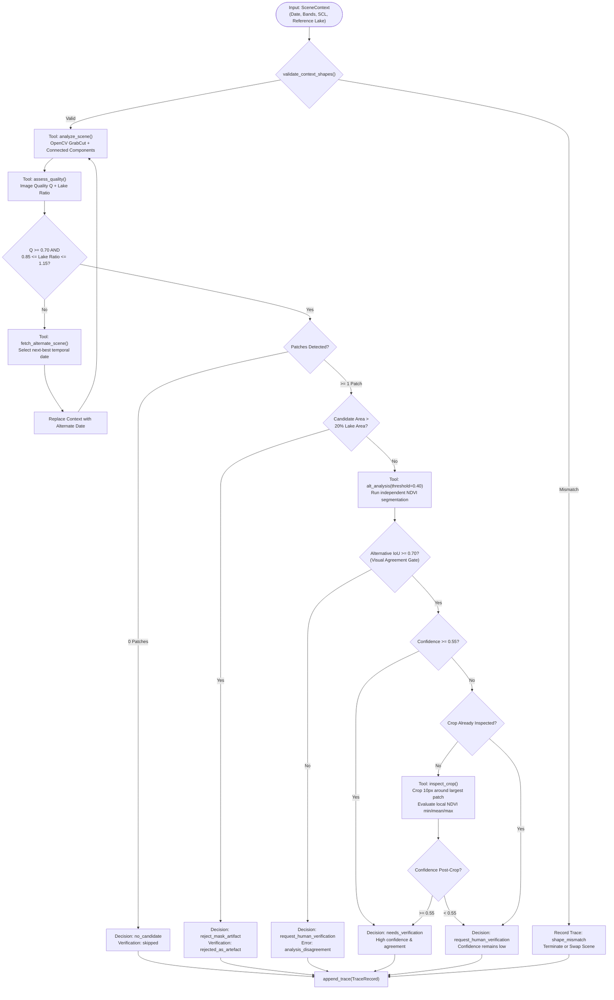

# Agentic Vision with OpenCV 5 — Technical Evidence Dossier
**OpenCV AI Competition 2026 Special Prize Track: Agentic Vision**  
**Repository:** ZiwaVision (`src/inspector.py`, `src/tools.py`, `src/agent.py`, `src/trace.py`)  

---

## 1. Executive Summary & Core Hypothesis

Traditional environmental remote sensing follows a static, unidirectional pipeline:
$$\text{Image Ingestion} \longrightarrow \text{Filter / Threshold} \longrightarrow \text{Alert Generation}$$

In real-world equatorial lake environments, this naive pattern produces catastrophic false alarm rates and wasted resources. Seasonal sediment plumes from rivers look green; scattered cloud edges boost local vegetation contrast; and sun glint creates spectral anomalies.

### The Agentic Vision Hypothesis
Rather than treating a single computer vision pass as ground truth, an intelligent vision agent must treat early detections as **hypotheses to be investigated**. The agent must possess:
1. A **menu of typed, deterministic computer vision tools** that can probe candidate regions at multiple scales and spectral sensitivities.
2. A **stateful reasoning loop** where the output numbers of one vision tool decide what tool to invoke next.
3. An **immutable audit trail** that records every visual observation, mathematical gate, and subsequent branch.
4. An **escalation boundary** that refuses to make unsubstantiated autonomous assertions, invoking human operator review when uncertainty or analysis disagreement is detected.

In ZiwaVision, this hypothesis is substantiated in working code by the **Active Inspector**.

---

## 2. Active Inspector State Machine & Workflow



---

## 3. The Typed Vision Tool Menu

The Active Inspector does not rely on an unconstrained Large Language Model making arbitrary hallucinations. It uses typed, deterministic tools implemented in [`src/tools.py`](file:///home/grace/Projects/CODEINE/hackathonTingz/ZiwaVision/src/tools.py):

| Tool Name | Input Arguments | Output Typed Dataclass | Visual Operation |
|---|---|---|---|
| `analyze_scene` | `context: SceneContext` | `AnalyzeEvidence` | Computes OpenCV GrabCut segmentation, extracts connected component patches, measures candidate area (ha) and open-water core pixels. |
| `assess_quality` | `context: SceneContext` | `QualityEvidence` | Evaluates localized cloud fraction, SCL unclassified pixels, quality score $Q$, and lake pixel stability against multi-date consensus mask. |
| `alt_analysis` | `context, first, threshold=0.40` | `AlternativeEvidence` | Executes independent thresholded segmentation and measures spatial Intersection-over-Union (IoU) between primary and alternative segmentations. |
| `inspect_crop` | `context, patch: Patch` | `CropEvidence` | Crops a 10-pixel bounding box window around the patch, computing localized NDVI distribution (min, mean, max) and shore distance in metres. |
| `fetch_alternate_scene` | `context, used_dates` | `FetchEvidence` | Queries available temporal observations, ranking candidates by box-level cloud cover to select the cleanest alternative. |
| `request_human_verification` | `analyze: AnalyzeEvidence` | `HumanEvidence` | Packages visual evidence, sets verification status to pending, and locks autonomous state until human review. |

---

## 4. Empirical Evidence: Visual Results Changing Subsequent Actions

Below is empirical evidence generated from real Sentinel-2 satellite observations and preserved in the JSONL audit traces.

### Case 1: Analysis Disagreement Triggers Human Escalation (2026-08-23)
- **Scene:** `S2C_36MXE_20260823_0_L2A`
- **Initial Observation:** 1 candidate patch detected; total area = 110.86 ha; open-water core = 4.05 ha.
- **Agent Reasoning:** The patch is substantial, but does it represent genuine vegetation or water turbidity?
- **Subsequent Action:** The agent executes `alt_analysis` with threshold $0.40$.
  - First analysis (GrabCut + NDVI 0.30): 405 open-water pixels.
  - Alternative analysis (NDVI > 0.40): 57 pixels.
  - Spatial Intersection-over-Union: $\text{IoU} = \frac{57}{405} = 0.141$.
- **Subsequent Decision:** Because $\text{IoU} = 0.141 < 0.70$ (the chosen agreement threshold), the analyses disagree. Instead of autonomously approving the hotspot, the agent immediately escalates:
  $$\text{Action: } \mathbf{request\_human\_verification} \quad (\text{Reason: "Alternative analysis IoU=0.141 < 0.70; analyses disagree."})$$
- **Trace Record:**
  ```json
  {
    "step": 0,
    "action": "alt_analysis",
    "observation": {"alternative_iou": 0.141, "candidate_area_ha": 110.86, "candidate_pixels": 11075.0, "n_patches": 1.0},
    "decision": "alt_analysis",
    "outcome": "NDVI formula=(NIR-red)/(NIR+red); threshold=0.40, first=405px, alternate=57px, IoU=0.141."
  }
  {
    "step": 1,
    "action": "request_human_verification",
    "error_category": "analysis_disagreement",
    "decision": "request_human_verification",
    "rule": "Alternative analysis IoU=0.141 < 0.70; analyses disagree.",
    "outcome": "Human verification pending: total candidate area=110.99 ha (11099 px); open-water core=4.05 ha (405 px)."
  }
  ```

---

### Case 2: Area Anomaly Guard Rejects Mask Artifact (2026-08-28)
- **Scene:** `S2B_36MXE_20260828_0_L2A`
- **Initial Observation:** High spectral vegetation signal detected over 2,080.79 ha.
- **Agent Reasoning:** The entire Dunga Beach reference lake area is 4,610 ha. An apparent vegetation patch covering 45.1% of the entire bay is physically implausible for an overnight shift.
- **Subsequent Action:** The agent invokes the area anomaly gate:
  $$\text{Area Fraction} = \frac{2080.79}{4610.10} = 0.451 > 0.20$$
- **Subsequent Decision:** Rather than emitting a false alarm or dispatching boats to non-existent weed, the agent automatically classifies the scene as an artifact:
  $$\text{Action: } \mathbf{reject\_mask\_artifact} \quad (\text{Verification Status: } \mathbf{rejected\_as\_artefact})$$
- **Trace Record:**
  ```json
  {
    "step": 0,
    "action": "reject_mask_artifact",
    "decision": "reject_mask_artifact",
    "rule": "candidate area=2080.79 ha is 0.451 of lake area=4610.10 ha, > 0.20.",
    "outcome": "candidate area=2080.79 ha is 0.451 of lake area=4610.10 ha, > 0.20.",
    "reassessment": {"candidate_area_ha": 2080.79, "candidate_pixels": 208079.0, "n_patches": 1.0}
  }
  ```

---

### Case 3: Atmospheric Cloud Distortion Triggers Scene Swap
- **Scenario:** Localized convective cumulus clouds obscure the observation window, reducing localized image quality $Q < 0.70$ or causing the detected water surface area to fluctuate by $> 15\%$.
- **Agent Reasoning:** The current observation is uninterpretable; attempting segmentation will generate false positives along cloud shadow boundaries.
- **Subsequent Action:** The agent executes `fetch_alternate_scene(used_dates)`. It ranks neighbouring temporal scenes from the STAC catalogue by cloud fraction.
- **Subsequent Decision:** The agent swaps the active `SceneContext` to the clean temporal neighbour and restarts analysis on reliable data.

---

### Case 4: Low-Confidence Detection Triggers Localized Patch Cropping
- **Scenario:** A small candidate patch is detected with marginal confidence ($C \in [0.30, 0.55)$).
- **Subsequent Action:** The agent fires `inspect_crop(context, patch)`, extracting a sub-image window padded by 10 pixels around the patch.
- **Measurement:** It evaluates localized NDVI statistics (`crop_ndvi_min`, `crop_ndvi_mean`, `crop_ndvi_max`) and calculates the exact Euclidean distance to the shoreline (`dist_to_shore_m`).
- **Subsequent Decision:** If localized mean NDVI remains below threshold or distance to shore is negligible (indicating rooted coastal papyrus), the agent marks the detection uncertain or routes to human review.

---

## 5. Mathematical Formulations

### 5.1 Image Quality Score ($Q$)
Evaluates localized optical atmospheric clarity using the Sentinel-2 Scene Classification Layer (SCL):
$$Q = \mathrm{clip}\left(1.0 - f_{\mathrm{cloud}} - 0.5 \times f_{\mathrm{unclassified}}, \; 0.0, \; 1.0\right)$$
Where:
- $f_{\mathrm{cloud}}$ is the fraction of pixels classified as cloud shadow (3), defective (1), cloud medium/high probability (8, 9), or thin cirrus (10).
- $f_{\mathrm{unclassified}}$ is the fraction classified as unclassified (7), penalized at half-weight due to ambiguity.

### 5.2 Patch Detection Confidence ($C$)
Multi-criteria heuristic combining geometry and spectral properties:
$$C = 0.30 \cdot S_{\mathrm{size}} + 0.30 \cdot S_{\mathrm{ndvi}} + 0.25 \cdot S_{\mathrm{coherence}} + 0.15 \cdot S_{\mathrm{scl}}$$
Where:
- $S_{\mathrm{size}} = \min\left(1.0, \frac{\ln(1 + A / 0.1)}{\ln(1 + 50.0)}\right)$ (log-scaled saturation at 5 ha).
- $S_{\mathrm{ndvi}} = \min\left(1.0, \max\left(0.0, \frac{\overline{\mathrm{NDVI}} - 0.30}{0.70 - 0.30}\right)\right)$.
- $S_{\mathrm{coherence}}$ is the fraction of patch pixels strictly exceeding the NDVI threshold.
- $S_{\mathrm{scl}}$ is the fraction of pixels independently classified as vegetation (class 4) by the ESA SCL model.

### 5.3 Alternative Analysis Spatial Agreement (IoU)
$$\mathrm{IoU}(M_1, M_2) = \frac{|M_1 \cap M_2|}{|M_1 \cup M_2|}$$
Where $M_1$ is the primary segmentation ($\mathrm{NDVI} > 0.30$ refined by GrabCut) and $M_2$ is the strict thresholded mask ($\mathrm{NDVI} > 0.40$). An $\mathrm{IoU} \ge 0.70$ demonstrates visual consensus; $\mathrm{IoU} < 0.70$ denotes ambiguity and mandates human review.

---

## 6. Verification and Reproducibility

To re-run and verify the Agentic Vision demonstrations live against real satellite data and controlled failure cases:

```bash
# 1. Run the live multi-case demonstration
./venv/bin/python src/demonstrate_cases.py

# 2. Run the 6-case controlled fault-injection demonstration
./venv/bin/python src/run_fault_demo.py

# 3. Run the automated inspector unit test suite
./venv/bin/pytest tests/test_inspector.py
```
