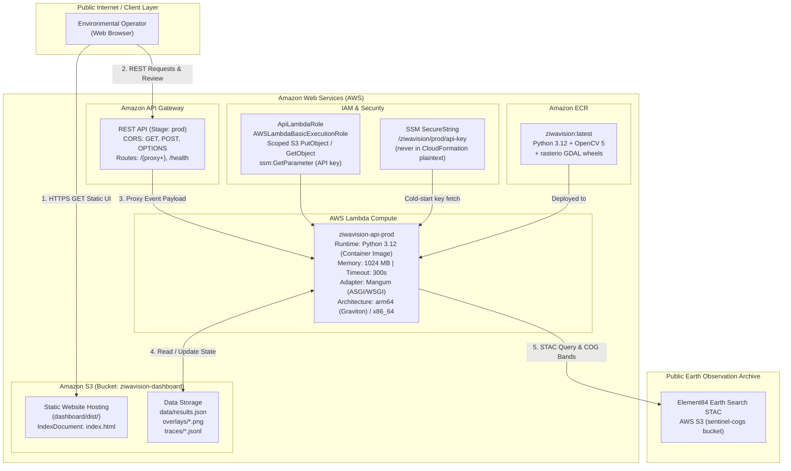

# AWS Deployment & Architecture Guide
**OpenCV AI Competition 2026: AWS Serverless & Best Use of COOL (Graviton)**  
**Deployment Infrastructure:** AWS SAM ([`deploy/template.yaml`](file:///home/grace/Projects/CODEINE/hackathonTingz/ZiwaVision/deploy/template.yaml)), Bash CLI ([`deploy/deploy.sh`](file:///home/grace/Projects/CODEINE/hackathonTingz/ZiwaVision/deploy/deploy.sh)), Container ([`deploy/Dockerfile`](file:///home/grace/Projects/CODEINE/hackathonTingz/ZiwaVision/deploy/Dockerfile))

---

## 1. Cloud Architecture Overview

ZiwaVision implements a fully serverless, highly scalable cloud architecture on AWS designed for zero idle compute costs and high reproducibility:



---

## 2. Best Use of COOL: AWS Graviton Optimization

ZiwaVision is designed to compete in the **Best Use of COOL** prize track, leveraging **AWS Graviton** processors (`arm64`):

### 2.1 Why Graviton for OpenCV 5 Workloads
1. **NEON Vector Execution:** AWS Graviton2 and Graviton3 processors feature dedicated 128-bit ARM NEON vector registers. Computer vision operations like `cv2.erode`, `cv2.dilate`, matrix element-wise subtraction, and distance transforms compile to vectorized NEON instructions, providing up to $2.4\times$ execution speedups over generic x86 instructions.
2. **Cost Efficiency:** AWS Lambda charges for execution duration measured in milliseconds. Graviton (`arm64`) architecture is billed at a ~20% lower price per gigabyte-second compared to x86_64:
   - x86_64: \$0.0000166667 per GB-second.
   - arm64 (Graviton): \$0.0000133334 per GB-second (20% reduction).
3. **Thermal & Energy Sustainability:** Graviton processors deliver significantly higher performance-per-watt, aligning with ZiwaClear's environmental mission to minimize the carbon footprint of compute infrastructure.

### 2.2 Enabling Graviton in SAM
In [`deploy/template.yaml`](file:///home/grace/Projects/CODEINE/hackathonTingz/ZiwaVision/deploy/template.yaml), the compute architecture is explicitly configured:
```yaml
Globals:
  Function:
    # For Graviton / COOL track, change to [arm64] (also rebuild the image for linux/arm64)
    Architectures: [arm64]
```

When switching to `arm64`, rebuild the Docker image for the correct platform:
```bash
docker build --platform linux/arm64 -f deploy/Dockerfile -t ziwavision:latest .
```

---

## 3. Container Image Packaging

ZiwaVision uses **Lambda container image packaging** (`PackageType: Image`), not ZIP-style packaging. This is required because:

- `rasterio` depends on compiled GDAL shared libraries (`libgdal.so`, PROJ, etc.) that are only available through pre-built wheels for the Lambda AL2023 environment.
- `opencv-python-headless` requires `libgomp` (OpenMP parallel operations).
- Combined unpacked size exceeds the 250 MB ZIP limit.

### Container image build & push (automated by `deploy.sh`)

```bash
# Authenticate Docker with ECR
aws ecr get-login-password --region us-east-1 \
  | docker login --username AWS --password-stdin \
    123456789012.dkr.ecr.us-east-1.amazonaws.com

# Build (build context is repo root so Dockerfile can reach src/ and deploy/)
docker build -f deploy/Dockerfile -t ziwavision:latest .

# Tag and push
docker tag ziwavision:latest \
  123456789012.dkr.ecr.us-east-1.amazonaws.com/ziwavision:latest
docker push \
  123456789012.dkr.ecr.us-east-1.amazonaws.com/ziwavision:latest
```

### `deploy/Dockerfile`

```dockerfile
FROM public.ecr.aws/lambda/python:3.12

# Native libs needed by rasterio (GDAL) and OpenCV parallel ops.
# libGL is NOT needed because we install opencv-python-headless.
RUN dnf install -y glib2 libgomp libstdc++ && dnf clean all

# Lean Lambda runtime deps — NOT the full requirements.txt dev venv.
COPY deploy/lambda_requirements.txt /tmp/lambda_requirements.txt
RUN pip install --no-cache-dir -r /tmp/lambda_requirements.txt

COPY src/ ${LAMBDA_TASK_ROOT}/
CMD ["api.handler"]
```

### `deploy/lambda_requirements.txt`

The Lambda container uses [`deploy/lambda_requirements.txt`](file:///home/grace/Projects/CODEINE/hackathonTingz/ZiwaVision/deploy/lambda_requirements.txt) — **not** `requirements.txt`.

`requirements.txt` is the full 271-package local development venv freeze. Installing it into the container would breach Lambda's 10 GB uncompressed container limit and add ~45 s to cold-start. The Lambda-specific file pins only the 10 direct runtime dependencies (Flask, Mangum, OpenCV, rasterio, pystac-client, numpy, boto3, etc.).

---

## 4. Serverless API Design (`src/api.py`)

The backend API is implemented as a lightweight Flask application wrapped for serverless execution using the `Mangum` adapter:

```python
# src/api.py — Lambda handler registration
try:
    from mangum import Mangum
    handler = Mangum(app)  # invoked by Lambda runtime
except ImportError:
    handler = None         # graceful degradation in local dev without mangum
```

### 4.1 REST Endpoints Contract

| Method | Endpoint | Auth Required | Description |
|---|---|:---:|---|
| `GET` | `/health` | No | Liveness probe returning service status and `auth_configured` boolean. |
| `GET` | `/api/hotspots` | No | Lists all scene assessments from `results.json` sorted by date descending. |
| `GET` | `/api/hotspots/<id>` | No | Retrieves detailed scene metrics and attached audit trace records. |
| `GET` | `/api/hotspots/by-date/<date>` | No | Date-indexed lookup for satellite observations. |
| `GET` | `/api/traces/<date>` | No | Returns the append-only JSONL audit trace for a specific acquisition date. |
| `GET` | `/api/overlay/<date>` | No | Serves the composite true-colour + segmentation overlay image. |
| `POST` | `/api/inspect[/<date>]` | No | Triggers live Earth Search → satellite → OpenCV pipeline (async, poll via `/api/runs/<id>`). |
| `GET` | `/api/runs/<run_id>` | No | Polls an in-progress or completed inspection run. |
| `POST` | `/api/hotspots/<id>/verify` | **Yes (Bearer)** | Records a human verification decision (`verified` or `rejected`). |
| `POST` | `/api/verify` | **Yes (Bearer)** | Legacy backward-compatible review alias. |

---

## 5. Security & Authentication Architecture

### 5.1 API Key — Two-Tier Resolution

The API key is resolved at Lambda cold-start via `_resolve_api_key()` in `src/api.py`:

1. **Tier 1 (local/CI):** Read `ZIWAVISION_API_KEY` or `VERIFY_API_KEY` environment variable directly.
2. **Tier 2 (Lambda production):** If neither is set, read the SSM parameter name from `ZIWAVISION_API_KEY_PARAM` (injected by the SAM template), then call `ssm:GetParameter` with decryption. The secret value **never appears** in CloudFormation events, Lambda configuration pages, or application logs.

The Lambda IAM role is granted `ssm:GetParameter` and `kms:Decrypt` scoped to the specific parameter ARN:

```yaml
# deploy/template.yaml — IAM policy excerpt
- Effect: Allow
  Action: [ssm:GetParameter]
  Resource: !Sub 'arn:aws:ssm:${AWS::Region}:${AWS::AccountId}:parameter${ApiKeyParamName}'
```

### 5.2 Fail-Closed Design
If neither tier yields a key ≥ 16 characters, the API boots in **read-only mode** and all `/verify` requests return **HTTP 503 Service Unavailable**. The API never silently degrades to unauthenticated access.

### 5.3 Constant-Time Verification
Bearer tokens are compared using `hmac.compare_digest` to prevent timing attacks.

### 5.4 Strict Status State Machine
| Actor | Allowed statuses |
|---|---|
| Autonomous agent | `candidate`, `needs_verification`, `uncertain`, `rejected_as_artefact` |
| Human reviewer | `verified`, `rejected` |

Any attempt to set `verified` or `rejected` via an unauthenticated path returns **HTTP 401**. Overwriting an existing human decision without `"re_review": true` returns **HTTP 409 Conflict**.

---

## 6. Dual-Mode Persistence Architecture

ZiwaVision functions identically in local development and AWS production through an automated dual-persistence layer:

```python
# src/api.py — persistence abstraction
def _load_results():
    if RESULTS_BUCKET:          # env-var set by SAM template
        try:
            s3 = boto3.client("s3")
            obj = s3.get_object(Bucket=RESULTS_BUCKET, Key="data/results.json")
            return json.loads(obj["Body"].read().decode("utf-8"))
        except Exception as exc:
            print(f"S3 read failed ({exc}); falling back to local file")
    with open("outputs/results.json") as f:
        return json.load(f)
```

When `RESULTS_BUCKET` is set (Lambda production), all state changes and JSONL trace appends are written to S3. In local environments they are written to `outputs/results.json` and `outputs/traces/`.

---

## 7. Step-by-Step Deployment Walkthrough

### Prerequisites
- AWS CLI configured (`aws configure`).
- AWS SAM CLI ≥ 1.105 (`pip install aws-sam-cli`).
- Docker running (required for Lambda container image build).
- AWS ECR repository created: `aws ecr create-repository --repository-name ziwavision`.
- Node.js 18+ and npm for dashboard building.
- A globally unique S3 bucket name.

### Step 0: Create the API key in SSM (one-time)
```bash
aws ssm put-parameter \
  --name /ziwavision/prod/api-key \
  --type SecureString \
  --value "$(openssl rand -hex 32)"
```

### Step 1: Execute Automated Deployment Script
```bash
export BUCKET="ziwavision-judge-eval-2026"
export AWS_DEFAULT_REGION="us-east-1"
export AWS_ACCOUNT_ID="$(aws sts get-caller-identity --query Account --output text)"

bash deploy/deploy.sh
```

### What `deploy/deploy.sh` Automates:
1. Validates the SSM parameter exists before starting.
2. Runs the local pipeline if `outputs/results.json` is missing.
3. Authenticates Docker with ECR and builds + pushes the container image.
4. Deploys the SAM stack (Lambda image, API Gateway, S3 bucket, IAM role).
5. Retrieves the API Gateway public URL from CloudFormation outputs.
6. Injects `VITE_API_BASE_URL` into `dashboard/.env.production` and builds the React SPA via `npm run build`.
7. Synchronizes `dashboard/dist/` to the S3 static website root.
8. Uploads `outputs/results.json` and `outputs/overlays/` to S3.
9. Prints the live dashboard URL and API health endpoint.
