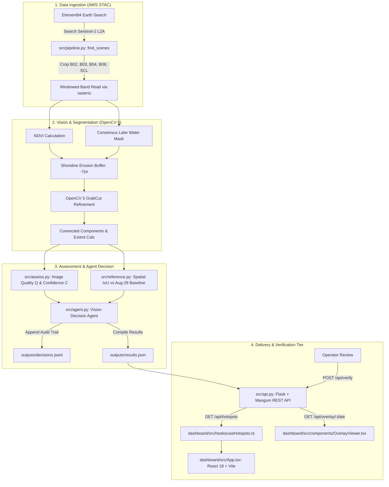

# ZiwaVision: System Architecture, Concepts & Re-creation Guide

A comprehensive architectural map and technical concept guide for **ZiwaVision (Visual Hotspot Verification)**.

This document records the exact mechanics, code implementations, mathematical formulas, and computer vision patterns developed for the project across the Python backend, OpenCV 5 image processing, and React + TypeScript frontend. Use this as a complete blueprint to understand, debug, or recreate the entire system from scratch.

---

## Table of Contents
1. [Executive Summary & Problem Statement](#1-executive-summary--problem-statement)
2. [End-to-End System Architecture](#2-end-to-end-system-architecture)
3. [Image Processing & Computer Vision (OpenCV 5)](#3-image-processing--computer-vision-opencv-5)
4. [Python Backend & Agentic Architecture](#4-python-backend--agentic-architecture)
5. [Frontend Engineering (React + TypeScript + Vite)](#5-frontend-engineering-react--typescript--vite)
6. [Data Schema & State Contracts](#6-data-schema--state-contracts)
7. [Step-by-Step Re-creation Walkthrough](#7-step-by-step-re-creation-walkthrough)

---

## 1. Executive Summary & Problem Statement

### 1.1 The Ecological & Economic Challenge
Water hyacinth (*Pontederia crassipes*) is an aggressive aquatic weed on Lake Victoria. It doubles in biomass every 5–15 days under favorable conditions, forming dense floating mats that:
- Trap fishing boats in port bays (such as Winam Gulf / Dunga Beach near Kisumu, Kenya).
- Suffocate native aquatic biodiversity by blocking sunlight and depleting dissolved oxygen.
- Obstruct municipal freshwater intakes and transport ferries.

### 1.2 The Role of ZiwaClear & The Dispatch Bottleneck
The parent initiative, **ZiwaClear**, organizes local harvesters into paid collection cooperatives, turning invasive hyacinth into commercial bio-fertilizer, biofuel briquettes, and artisan handicrafts. Harvesters are managed and compensated via USSD/SMS and M-Pesa.

**The Bottleneck:** Harvesters previously suffered from *blind dispatch*. Wind patterns and lake currents displace huge weed mats across the open gulf overnight. Harvesters wasted scarce fuel and daylight scouting by boat without knowing where dense mats had drifted.

### 1.3 The ZiwaVision Solution
ZiwaVision operates an autonomous visual verification pipeline:
1. Ingests free Copernicus Sentinel-2 optical satellite data via AWS STAC.
2. Isolates the lake surface using a multi-date consensus water mask.
3. Segments candidate floating vegetation using NDVI and OpenCV 5 GrabCut.
4. Scores scene image quality and detection confidence against a vetted reference baseline.
5. Employs a rule-based vision agent to route hotspots (`process_another_observation`, `request_human_verification`, or `flag_uncertain`).
6. Delivers a web dashboard where human operators can inspect overlays and confirm verifications before boats are dispatched.

> **Strict Language Invariant:** Detections are formally designated as **candidate floating vegetation** (never "hyacinth") until a human operator marks them as verified.

---

## 2. End-to-End System Architecture



### Module Responsibilities Map

| File | Primary Responsibility | Key Functions / Classes |
|---|---|---|
| [`src/pipeline.py`](file:///home/grace/Projects/CODEINE/hackathonTingz/ZiwaVision/src/pipeline.py) | STAC scene discovery, windowed CRS band extraction, consensus lake mask | `find_scenes()`, `read_band()`, `lake_mask()`, `reference_lake()` |
| [`src/vision.py`](file:///home/grace/Projects/CODEINE/hackathonTingz/ZiwaVision/src/vision.py) | OpenCV 5 segmentation, GrabCut refinement, patch extraction | `ndvi_of()`, `candidates_mask()`, `detect_patches()`, `Patch` |
| [`src/reference.py`](file:///home/grace/Projects/CODEINE/hackathonTingz/ZiwaVision/src/reference.py) | Reference baseline extraction from 2026-08-28 scene, spatial IoU calculation | `build_reference_mask()`, `compare_to_reference()` |
| [`src/assess.py`](file:///home/grace/Projects/CODEINE/hackathonTingz/ZiwaVision/src/assess.py) | Quality scoring, patch confidence evaluation, scene assessment object | `SceneAssessment`, `build_scene_assessment()` |
| [`src/agent.py`](file:///home/grace/Projects/CODEINE/hackathonTingz/ZiwaVision/src/agent.py) | Rule-based decision routing, immutable audit logging, human verification | `decide()`, `log_decision()`, `apply_verification()` |
| [`src/run_pipeline.py`](file:///home/grace/Projects/CODEINE/hackathonTingz/ZiwaVision/src/run_pipeline.py) | End-to-end multi-scene batch orchestrator | `main()`, generates `results.json` & overlay PNGs |
| [`src/api.py`](file:///home/grace/Projects/CODEINE/hackathonTingz/ZiwaVision/src/api.py) | REST API endpoints with CORS and AWS Lambda adapter | `get_hotspots()`, `get_overlay()`, `verify()` |
| [`dashboard/src/App.tsx`](file:///home/grace/Projects/CODEINE/hackathonTingz/ZiwaVision/dashboard/src/App.tsx) | Root React application layout, state coordinator, and toast alerts | `App` |
| [`dashboard/src/hooks/useHotspots.ts`](file:///home/grace/Projects/CODEINE/hackathonTingz/ZiwaVision/dashboard/src/hooks/useHotspots.ts) | Declarative data fetching hook with offline fixture fallback | `useHotspots()` |
| [`dashboard/src/hooks/useVerify.ts`](file:///home/grace/Projects/CODEINE/hackathonTingz/ZiwaVision/dashboard/src/hooks/useVerify.ts) | Mutation hook for POST verification with in-flight locking | `useVerify()` |

---

## 3. Image Processing & Computer Vision (OpenCV 5)

### 3.1 Spectral Normalized Difference Vegetation Index (NDVI)
Living green vegetation strongly absorbs Red light (for photosynthesis) while reflecting Near-Infrared (NIR) radiation through its spongy mesophyll leaf structure. Pure water absorbs both red and NIR light, yielding negative NDVI values.

$$\text{NDVI} = \frac{\text{NIR} - \text{Red}}{\text{NIR} + \text{Red}} = \frac{\text{B08} - \text{B04}}{\text{B08} + \text{B04}}$$

**Code Implementation ([`src/vision.py`](file:///home/grace/Projects/CODEINE/hackathonTingz/ZiwaVision/src/vision.py)):**
```python
def ndvi_of(red: np.ndarray, nir: np.ndarray) -> np.ndarray:
    """Compute Normalized Difference Vegetation Index from Red and NIR bands."""
    denom = nir + red
    # Use np.errstate to handle division by zero in shadow/black pixels gracefully
    with np.errstate(divide='ignore', invalid='ignore'):
        ndvi = np.where(denom > 0, (nir - red) / denom, 0.0)
    return np.clip(ndvi, -1.0, 1.0).astype(np.float32)
```

### 3.2 Consensus Lake Surface Isolation
To prevent mainland farmland and terrestrial vegetation from contaminating the detection of floating weeds, we isolate the lake water body.

1. **Connected Component Analysis on SCL:** The Scene Classification Layer assigns class `6` to water. We run connected components to find the single largest contiguous water polygon (the main Winam Gulf water body).
2. **Hole Filling via External Contours:** Harvester boats can enter weed-choked bays. If an invasive mat is dense enough, SCL may classify it as "vegetation" (class `4`) rather than "water" (class `6`). By finding external contours of the lake and filling interior holes, we ensure floating mats inside the lake perimeter remain inside the lake mask:
```python
# src/pipeline.py: lake_mask()
water = (scl == 6).astype("uint8")
n, labels, stats, _ = cv2.connectedComponentsWithStats(water, connectivity=8)
biggest = 1 + np.argmax(stats[1:, cv2.CC_STAT_AREA])
lake = (labels == biggest).astype("uint8")

contours, _ = cv2.findContours(lake, cv2.RETR_EXTERNAL, cv2.CHAIN_APPROX_SIMPLE)
filled = np.zeros_like(lake)
cv2.drawContours(filled, contours, -1, 1, thickness=cv2.FILLED)
```

3. **Multi-Date Consensus Masking:** A single satellite pass might suffer localized cloud shadow or shoreline glare. `reference_lake(masks, min_share=0.6)` aggregates across clear scenes, retaining a pixel as lake only if it was identified as water in at least 60% of clear scenes (~4,610 ha).

### 3.3 Shoreline Erosion Buffer
Terrestrial shoreline reeds, papyrus, and swamp marshes line the edge of Lake Victoria. To prevent these emergent wetlands from falsely triggering as floating mats, we apply morphological erosion:
```python
# src/vision.py: candidates_mask()
# Erode lake mask inwards by 7 pixels (70 meters)
kernel = cv2.getStructuringElement(cv2.MORPH_ELLIPSE, (erode_shore_px * 2 + 1, erode_shore_px * 2 + 1))
eroded_lake = cv2.erode(lake_filled, kernel)
candidates = ((ndvi >= ndvi_threshold) & (eroded_lake == 1)).astype(np.uint8)
```

### 3.4 OpenCV 5 GrabCut Boundary Refinement
Simple NDVI thresholding produces noisy, jagged pixel edges. ZiwaVision uses **OpenCV 5 GrabCut** (`cv2.grabCut`), an iterative graph-cut energy minimization algorithm based on Gaussian Mixture Models (GMMs).

- **Seeding Strategy:**
  - High NDVI core pixels ($\text{NDVI} \ge 0.50$): Initialized as **`GC_FGD` (Definite Foreground)**.
  - Moderate NDVI pixels ($0.35 \le \text{NDVI} < 0.50$): Initialized as **`GC_PR_FGD` (Probable Foreground)**.
  - Open water lake pixels ($\text{NDVI} < 0.20$): Initialized as **`GC_PR_BGD` (Probable Background)**.
  - Shoreline and land pixels outside eroded lake: Initialized as **`GC_BGD` (Definite Background)**.
```python
# src/vision.py: grabcut_refine()
mask[strong_core] = cv2.GC_FGD
mask[moderate_green] = cv2.GC_PR_FGD
mask[clean_water] = cv2.GC_PR_BGD
mask[eroded_lake == 0] = cv2.GC_BGD

bgdModel = np.zeros((1, 65), np.float64)
fgdModel = np.zeros((1, 65), np.float64)

cv2.grabCut(rgb_uint8, mask, None, bgdModel, fgdModel, iterCount=iter_count, mode=cv2.GC_INIT_WITH_MASK)

refined_mask = np.where((mask == cv2.GC_FGD) | (mask == cv2.GC_PR_FGD), 1, 0).astype(np.uint8)
```

### 3.5 Discrete Patch Extraction & Metric Calculation
Once refined, contiguous candidate patches are extracted via 8-connectivity connected components:
- **Pixel Area to Hectares:**
  $$\text{Area (ha)} = \text{Pixel Count} \times \frac{10\text{ m} \times 10\text{ m}}{10{,}000\text{ m}^2/\text{ha}} = \text{Pixel Count} \times 0.01\text{ ha}$$
- **Centroid Coordinates:** Pixel centroid $(\bar{r}, \bar{c})$ mapped linearly to geographic WGS84 $(\text{lat}, \text{lon})$ using the scene's bounding box affine transform.
- **Size Filtering:** Patches smaller than 5 pixels ($< 0.05\text{ ha}$) are pruned to remove sensor noise.

---

## 4. Python Backend & Agentic Architecture

### 4.1 Multi-Dimensional Quality & Confidence Scoring
Detection confidence is not a species prediction; it is an objective model score ($C \in [0, 1]$) reflecting image clarity, spectral strength, and geometric stability.

1. **Image Quality Score ($Q$):**
   $$Q = 1.0 - (\text{Cloud Fraction} + \text{Unclassified Fraction})$$
2. **Patch Confidence ($C$):**
   Combines mean NDVI contrast, ratio of pixels labeled vegetation by Sentinel-2 SCL, and compactness ($\text{Area} / \text{Perimeter}^2$).
3. **Spatial Intersection-over-Union (IoU) vs Reference:**
   Measures spatial persistence against the clear reference baseline scene (2026-08-28):
   $$\text{IoU} = \frac{|A_{\text{detected}} \cap A_{\text{reference}}|}{|A_{\text{detected}} \cup A_{\text{reference}}|}$$

### 4.2 The Rule-Based Agent Loop (`src/agent.py`)
Rather than relying on non-deterministic LLM calls, the agent enforces explicit, data-driven domain rules:

```python
# src/agent.py: decide()
if assessment.image_quality < QUALITY_MIN (0.70):
    action = "process_another_observation"
    status = "skipped"
elif conf < CONFIDENCE_LOW (0.30):
    action = "flag_uncertain"
    status = "uncertain"
elif conf >= CONFIDENCE_HIGH (0.55) and iou >= REFERENCE_IOU_MIN (0.05) and area >= AREA_MIN_HA (0.05):
    action = "request_human_verification"
    status = "needs_review"
else:
    action = "process_another_observation"
    status = "skipped"
```

### 4.3 Immutable Audit Trail (`outputs/decisions.jsonl`)
Every decision the agent makes is appended to an immutable JSON Lines audit log:
```json
{"scene_id": "S2B_36MXE_20260907_0_L2A", "date": "2026-09-07", "action": "request_human_verification", "reason": "High confidence 0.72, scene IoU 0.184, 14.82 ha — candidate floating vegetation confirmed consistent with reference.", "image_quality": 0.95, "detection_confidence": 0.72, "reference_iou": 0.184, "n_patches": 4, "total_area_ha": 14.82, "verification_status": "needs_review", "decided_at": "2026-09-07T10:32:00Z"}
```

### 4.4 Flask REST API Architecture (`src/api.py`)
- Serves `GET /api/hotspots`, `GET /api/overlay/<date>`, and `POST /api/verify`.
- Cross-Origin Resource Sharing (CORS) enabled to allow both local dev (`http://localhost:5173`) and CloudFront origins.
- Uses `Mangum` ASGI/WSGI adapter to allow the identical Flask application to run locally or inside an AWS Lambda function with zero code changes.

---

## 5. Frontend Engineering (React + TypeScript + Vite)

### 5.1 Architecture & Design Decisions
The user dashboard was rebuilt as a modern **React 18 + TypeScript + Vite** application residing in [`dashboard/`](file:///home/grace/Projects/CODEINE/hackathonTingz/ZiwaVision/dashboard).

- **No Client-Side Routing:** State selection (`selectedDate: string | null`) is maintained in component state rather than React Router URL paths. This avoids 404 rewrite pitfalls on AWS S3 / CloudFront static hosting.
- **Zero-Dependency SVG Charting ([`AreaOverTimeChart.tsx`](file:///home/grace/Projects/CODEINE/hackathonTingz/ZiwaVision/dashboard/src/components/AreaOverTimeChart.tsx)):** Eliminates heavy external charting libraries by calculating coordinate paths and gradient fills directly in pure SVG, keeping bundle size minimal (<170 kB total).
- **Glassmorphism Design System:** Tailored dark palette using CSS custom properties (`--bg: #0b0f1a`, `--accent: #00e5a0`, `--accent2: #c8f56a`) with subtle backdrop filters, micro-animations, and high-contrast typography (`Inter` & `JetBrains Mono`).

### 5.2 Custom Hook Patterns

#### A. Data-Fetching Hook (`useHotspots`)
```typescript
// dashboard/src/hooks/useHotspots.ts
export function useHotspots(): UseHotspotsResult {
  const [hotspots, setHotspots] = useState<Hotspot[]>([]);
  const [isLoading, setIsLoading] = useState(true);
  const [error, setError] = useState<string | null>(null);
  const [isApiConnected, setIsApiConnected] = useState(false);

  const loadData = useCallback(async () => {
    setIsLoading(true);
    const healthy = await checkHealth();
    setIsApiConnected(healthy);

    if (healthy) {
      try {
        const data = await fetchHotspots();
        setHotspots(data);
      } catch (err) {
        setError('API Error: Falling back to offline fixtures');
        setHotspots(FIXTURE_HOTSPOTS);
      }
    } else {
      setHotspots(FIXTURE_HOTSPOTS);
    }
    setIsLoading(false);
  }, []);

  useEffect(() => { loadData(); }, [loadData]);
  return { hotspots, isLoading, error, isApiConnected, refetch: loadData, updateLocalHotspot };
}
```

#### B. Verification Mutation Hook (`useVerify`)
Manages `POST /api/verify` network submissions, locking interactive buttons during flight and triggering optimistic UI updates.

---

## 6. Data Schema & State Contracts

### 6.1 Hotspot Model (`dashboard/src/types/hotspot.ts`)
```typescript
export type VerificationStatus =
  | 'needs_review'
  | 'verified'
  | 'uncertain'
  | 'rejected'
  | 'skipped';

export type AgentAction =
  | 'request_human_verification'
  | 'process_another_observation'
  | 'flag_uncertain';

export interface PatchDetail {
  patch_id: number;
  area_ha: number;
  centroid_latlon: [number, number]; // [lat, lon]
  centroid_px: [number, number];     // [row, col]
  mean_ndvi: number;
  ndvi_fraction: number;
  scl_veg_fraction: number;
  confidence: number;
  reference_iou?: number;
  in_reference?: boolean;
}

export interface Hotspot {
  scene_id: string;
  date: string; // YYYY-MM-DD
  location: string;
  bbox: [number, number, number, number];
  image_quality: number;
  cloud_fraction: number;
  n_patches: number;
  total_area_ha: number;
  lake_area_ha: number;
  mean_patch_confidence: number;
  scene_iou: number;
  action: AgentAction;
  agent_reason: string;
  verification_status: VerificationStatus;
  decided_at: string;
  patch_details: PatchDetail[];
  verified_at?: string;
}
```

---

## 7. Step-by-Step Re-creation Walkthrough

If setting up this system on a brand new machine:

### 1. Python Environment Setup
```bash
git clone https://github.com/Gathoni-K/ziwaVision.git
cd ziwaVision

python3 -m venv venv
source venv/bin/activate
pip install -r requirements.txt
mkdir -p outputs/overlays
```

### 2. Run the Vision & Agent Pipeline
```bash
# Ingests Sentinel-2 scenes, calculates consensus water mask, runs GrabCut, and writes results.json
python src/run_pipeline.py
```

### 3. Launch Backend API
```bash
# Starts Flask server on port 5050
python src/api.py
```

### 4. Setup & Launch React Dashboard
```bash
cd dashboard
npm install
npm run dev
# Dashboard launches at http://localhost:5173
```

### 5. Production Build & Deployment
```bash
cd dashboard
npm run build
# Compiles optimized HTML/CSS/JS into dashboard/dist/ (ready for S3 + CloudFront sync)
```
